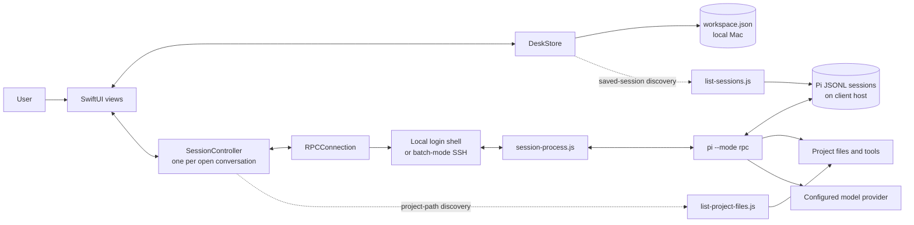
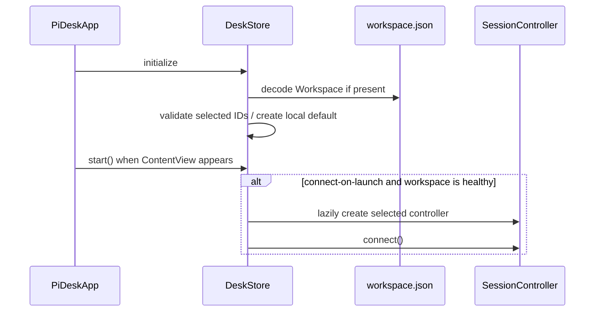

# PiDesk architecture

PiDesk is a native macOS SwiftUI application that presents Pi conversations running either on the same Mac or on a host reached through SSH. It is a process-oriented client: PiDesk does not embed Pi, call model providers directly, or attach to an existing Pi terminal process. Each open conversation owns a `pi --mode rpc` child process.

## System context



“Client host” means the machine on which Pi executes. It is the application Mac for a local client and the SSH destination for a remote client. Pi, Node.js, Pi credentials, project files, session files, and tool execution all live on that host. Only PiDesk's workspace file always lives on the application Mac.

## Runtime topology

There are three kinds of subprocess:

1. **Conversation process** — one long-lived process per connected conversation. `RPCConnection` launches a login shell, optionally through SSH, which starts `session-process.js`; the helper supervises one Pi RPC process and owns its advisory session lock.
2. **Scoped-model probe** — a short-lived `pi --mode rpc --no-session` process used during connection to discover the models allowed by Pi's scoped-model configuration without writing model changes to the conversation.
3. **Read-only inventory process** — a short-lived Node helper for either saved-session metadata or project-file completion. These use the same local/SSH execution path and JSONL transport as Pi RPC.

Remote execution is not a background service. SSH and all child processes belong to the GUI process and are stopped on disconnect or application termination.

## Major components

| Component | Location | Responsibility |
| --- | --- | --- |
| Application and primary views | `Sources/PiDesk/PiDeskApp.swift` | App lifecycle, main window, sidebar, conversation transcript, composer, menus, export UI, clipboard image handling, and shutdown coordination. |
| Secondary views | `Sources/PiDesk/Sheets.swift` | Client configuration, settings/recovery, saved-session browser, rename/session-info sheets, and extension dialogs. |
| Message rendering | `Sources/PiDesk/MessageViews.swift` | Message/tool rows, lightweight Markdown parsing/rendering, and asynchronous image thumbnail decoding. |
| Application store | `Sources/PiDesk/DeskStore.swift` | Workspace ownership, client/session selection, controller registry, persistence, session opening, recovery, and process retirement. |
| Conversation controller | `Sources/PiDesk/SessionController.swift` | One conversation's observable state, connection handshake, command handling, streaming reduction, queue control, model/thinking changes, extension UI, attachments, and export. |
| Process/RPC transport | `Sources/PiDesk/RPCConnection.swift` | Child-process lifecycle, stdin/stdout/stderr pipes, LF-delimited JSON framing, request correlation, timeouts, event dispatch, and termination. |
| Domain and transport models | `Sources/PiDesk/Models.swift` | Persisted models, transient message models, completion logic, JSONL decoder, validation, shell quoting, and local/SSH invocation construction. |
| Resource lookup | `Sources/PiDesk/PiResources.swift` | Resolves SwiftPM resources both during development and inside the packaged `.app`. |
| Session supervisor | `Sources/PiDesk/Resources/session-process.js` | Runs Pi, proxies JSONL, acquires/releases host-side writer locks, and escalates shutdown if necessary. |
| Session inventory | `Sources/PiDesk/Resources/list-sessions.js` | Discovers saved Pi JSONL sessions and extracts bounded, read-only metadata with caching and progress events. |
| Project inventory | `Sources/PiDesk/Resources/list-project-files.js` | Supplies composer `@` completion paths using Git where possible and a filesystem walk otherwise. |

## State ownership

### Persisted by PiDesk

`DeskStore` owns a versioned `Workspace` containing:

- `Client` profiles: display name, local/SSH target, port, Pi executable, working directory, optional session directory, and conversation references;
- `SessionRecord` values: title, working directory, Pi session path or fork source, timestamps, draft, and delivery-unknown text;
- selected client/conversation IDs and the connect-on-launch preference.

The default path is:

```text
~/Library/Application Support/PiDesk/workspace.json
```

`PIDESK_WORKSPACE` can override it. Saves are debounced by 400 ms, encoded as versioned JSON, atomically replaced, and assigned mode `0600`. A corrupt or unsupported workspace disables persistence so empty defaults cannot overwrite the original. Recovery validates an import, backs up the current file, disconnects processes, replaces in-memory state, and deliberately does not auto-connect.

### Persisted by Pi

Pi owns authoritative conversation history and branch structure in its JSONL session files on the client host, normally under `~/.pi/agent/sessions/`. PiDesk stores only references to those files. Closing a conversation or removing a client never deletes Pi history.

### Transient state

A `SessionController` owns the current rendered messages, streaming blocks, model catalog, thinking options, queue, usage statistics, extension UI, project paths, and pending images. This state is reconstructed from Pi during connection and from subsequent events; it is not copied into `workspace.json`, except for the `SessionRecord` fields listed above.

`DeskStore` lazily creates one controller per `SessionRecord` and forwards each controller's `objectWillChange` to SwiftUI. A record-change callback copies controller mutations back into the matching client/session and schedules persistence.

## Execution and transport

### Command construction

`ProcessInvocation` validates profiles and constructs commands as follows:

- A login shell (`$SHELL -lc`) is used locally so version managers work from Finder launches.
- Remote clients use `/usr/bin/ssh` with batch mode, strict host-key checking, connection/server-alive timeouts, and the configured destination and port.
- Common executable fallback directories are appended to `PATH`.
- The command changes to the conversation working directory before launching Pi.
- Executable and path values are shell-quoted; SSH destinations are separately constrained to aliases, hostnames, bracketed IPv6 addresses, and optional user names.
- Pi-related session/model environment variables inherited from the launching agent are removed before child launch.

For a resumed conversation, Pi receives `--session`. When a saved conversation is moved to another working directory on the same host, it receives `--fork` so the active history is preserved in a new session with the new directory. A configured session directory is passed through as `--session-dir`.

### JSONL RPC

All process communication uses one JSON object per LF-terminated line:

- requests contain a generated `id`, a `type`, and command-specific fields;
- `type: "response"` records are correlated to pending continuations by ID;
- all other records are unsolicited events delivered to the controller;
- stdout is protocol-only, while the last 12 KB of stderr is retained for diagnostics;
- records may span arbitrary pipe reads, including split UTF-8 sequences;
- an unterminated record is bounded to 64 MB;
- writes are serialized on a dedicated dispatch queue.

Pipe reads happen off the main thread, then protocol decoding and all controller state changes are dispatched to the main actor. This keeps conversation state serialized. Request timeouts and process exit reject pending continuations. Prompt failures are classified separately when acceptance cannot be known.

## Key data flows

### 1. Application startup and selection



Selecting or creating a conversation updates selection, schedules a workspace save, obtains the controller, and explicitly connects it. Other connected controllers remain independent and can continue streaming while not selected.

### 2. Conversation connection and hydration

`SessionController.connect()` performs a guarded handshake tied to a unique connection-attempt ID:

1. Cancel old project discovery and clear transient extension/completion state.
2. Wait for any retiring process for this conversation to exit, preventing overlapping writers.
3. Build the local or SSH invocation and start `RPCConnection`.
4. Request `get_state`; capture model, thinking level, busy state, session path, and session name.
5. Request `get_available_models`, then use the no-session probe and `cycle_model` to enumerate the scoped subset.
6. Request `get_available_thinking_levels`.
7. Request `get_messages` and convert Pi content into display `ChatMessage` values.
8. Request `get_commands`; merge connected Pi commands with PiDesk's local `/compact` and `/name` commands.
9. Mark the controller connected, start project-file discovery, and request session usage statistics.

Every asynchronous stage checks that its `RPCConnection` is still current. Stale callbacks from a disconnected/replaced process are ignored.

### 3. Sending, steering, and images

The composer binds directly to `SessionRecord.draft`. Project paths and connected Pi commands generate local suggestions; applying one edits the draft only.

On send:

1. The controller checks connection/configuration state and blocks while delivery is unresolved.
2. PiDesk handles `/compact` and `/name` through their RPC equivalents. Known terminal-only commands are rejected with guidance unless Pi reported an extension command with that name.
3. Draft text and pending images are moved into an in-flight `Submission`; images are base64-encoded content blocks.
4. A `prompt` request is sent with `streamingBehavior: "steer"`. If Pi is already busy, Pi can queue it as a steering message.
5. Pi 1.1's prompt response disposition (`started`, `queued`, or `handled`) is validated. Queue/events—not the acceptance response—remain authoritative for run state. Prompt acceptance updates the record timestamp and refreshes Pi state.

Clipboard images are converted to PNG. The controller permits at most eight images, 20 MB each and 40 MB total. Transcript image blocks are decoded into bounded thumbnails off the main thread.

A normal rejected request restores text and images to the composer. A timeout, disconnect, or write interruption while a prompt is pending has ambiguous delivery: the text is persisted in `deliveryUnknown`, associated images are restored, and further sends are blocked until the user either treats it as sent or restores it for deliberate manual resend. Reconnect never replays a prompt automatically.

### 4. Streaming events to the transcript

```mermaid
flowchart LR
    Pi[Pi RPC events] --> RPC[RPCConnection.receive]
    RPC --> Handle[SessionController.handle]
    Handle --> Reduce[Streaming/tool reducers]
    Reduce --> Published[@Published state]
    Published --> SwiftUI[Conversation and MessageBubble]
```

The reducer handles:

- agent start/settled and retry/compaction activity;
- message start/update/end events;
- assistant text, thinking, and tool-call blocks keyed by `contentIndex` so interleaved deltas retain their order;
- tool start/update/end events consolidated into one row per `toolCallId`, including Pi 1.1's final `durationMs`;
- steering/follow-up queue updates;
- final message replacement without losing tool arguments;
- errors, notifications, statuses, widgets, and extension requests.

After the agent settles (including Pi 1.1's `aborted` settlement field), state and usage statistics are refreshed. Initial and post-compaction history is rebuilt from `get_messages`; assistant tool calls are joined to separate tool-result messages for a single UI row.

The transcript uses a lazy stack and geometry-driven follow-bottom behavior. Changes in streaming text, tools, disclosures, and thumbnails can alter row geometry. Separate scalar preferences track content height and the bottom marker, while follow-scroll requests are deferred and coalesced to avoid the feedback loop documented in [`docs/scroll-to-layout-loop.md`](docs/scroll-to-layout-loop.md). Scrolling away disables following until the user returns to the bottom, uses the jump control, or submits a message.

### 5. Stop and queue restoration

Stop first calls `clear_queue`, restores returned steering/follow-up text to the draft, then calls `abort` and refreshes state. This ordering prevents Pi from immediately continuing queued work after the active request is aborted. Escape invokes the same path while work is active.

### 6. Model, thinking, rename, and compaction

Model and thinking changes are disabled while the controller is busy or submitting. They use `set_model` and `set_thinking_level`, followed by state/capability refreshes. Rename uses `set_session_name` before updating the local record. Compaction uses the long-running `compact` request, reloads active messages, then refreshes state and usage.

### 7. Extension UI

Pi extension events are translated into native UI state:

- `select`, `confirm`, `input`, and `editor` requests become dialogs;
- user choices are sent as uncorrelated `extension_ui_response` records;
- `set_editor_text` replaces the draft;
- notifications become transcript rows;
- status and widget events populate composer-adjacent UI.

Timeouts are scoped to the current connection-attempt ID. All extension dialogs, widgets, statuses, and command caches are cleared on disconnect/reconnect so stale extension state cannot cross sessions.

### 8. Saved-session discovery and opening

The session browser launches `list-sessions.js` on the selected client host. The helper:

- resolves the configured/default Pi session directory;
- walks JSONL session files without mutating them;
- reads a fixed file-size snapshot so it does not chase an actively growing session;
- extracts only the session header, latest name, and first user prompt needed for display metadata;
- limits individual input records, skips malformed/unreadable entries, and reads metadata with bounded parallelism;
- emits progress events and reuses cached metadata when file identity, size, and timestamps match.

Cancellation closes stdin/stops the helper, including across SSH. Opening a result adds a `SessionRecord` pointing at the host-side path and follows the normal connection flow. PiDesk first reuses an already-open matching record on an equivalent configured host, while the host-side lock provides the stronger canonical-path check.

### 9. Project-path discovery and composer completion

After a conversation connects, `list-project-files.js` runs in its working directory. It prefers `git ls-files` (tracked plus non-ignored untracked files), falling back to a filesystem walk. `.git` is excluded and output is bounded to 20,000 entries/16 MB. Results remain transient and drive fuzzy `@path` completion. Discovery is optional: cancellation or failure does not disconnect a healthy conversation.

### 10. Export

Markdown export refreshes active-branch messages from Pi when connected, then emits visible text, thinking, tool arguments/results, and inline image data. Offline export uses the controller's last loaded messages. Full-history export calls `get_entries` and writes raw, pretty-printed JSON for all branches; it is an archival export, not an importable Pi JSONL file.

### 11. Disconnect and shutdown

Disconnect invalidates the connection attempt, cancels discovery, records any in-flight prompt as delivery-unknown, detaches callbacks, and closes RPC stdin. `RPCConnection` allows graceful exit, then sends `SIGTERM` and finally `SIGKILL` if needed. The Node supervisor independently gives Pi EOF and a shorter terminate/kill escalation before releasing locks.

`DeskStore` retains retiring connections until their processes have exited. Application termination is deferred while the store saves the workspace, disconnects all controllers, and waits for child cleanup.

## Session writer locking

`session-process.js` creates `<canonical-session-path>.pidesk-lock` on the client host and writes `owner.json` containing the supervisor PID, hostname, canonical session path, and start time.

- Existing sessions are locked before Pi starts.
- New/forked sessions are locked when Pi first discloses their path in a `get_state` response.
- Host-side `realpath` canonicalization makes local symlinks and SSH aliases converge on the same lock.
- Locks remain held until the supervised Pi process exits, including the controller's retiring period.
- Existing locks are never stolen automatically.

The lock is advisory among PiDesk instances only. Terminal Pi and other applications do not honor it, so users must still avoid opening the same session concurrently elsewhere.

## Security and trust boundaries

- Pi and its tools execute with the client host account's permissions; PiDesk adds no sandbox and does not automatically approve project trust.
- Provider credentials remain in Pi's configuration on the client host. SSH credentials remain in the user's SSH configuration/keychain/agent. PiDesk does not persist API keys or SSH passwords.
- SSH is non-interactive and refuses unknown host keys; users must establish host trust in a terminal first.
- Imported workspaces are trusted configuration because they contain executable paths and SSH destinations. Imports are validated and never auto-connected.
- Helpers are bundled application resources and sent to the client host as quoted `node -e` scripts. Both local and remote hosts therefore require Node.js.
- Remote image data, message content, tool output, and session export do cross the SSH/RPC boundary into the GUI; saved-session discovery returns metadata only.

## Concurrency and architectural invariants

Most mutable application and protocol state is `@MainActor`-isolated. Background work is limited to pipe reads, serialized writes, and image decoding, with results returned to the main actor.

Important invariants are:

1. A `SessionController` accepts events only from its current `RPCConnection`.
2. One controller exists per in-workspace `SessionRecord`; conversation streams do not share reducers.
3. A replacement connection waits for the previous writer to retire.
4. Prompt delivery ambiguity is persisted and requires an explicit user decision.
5. The workspace is never overwritten after a decode/version failure until recovery succeeds.
6. Pi session content remains authoritative on the client host and is never reconstructed from discovery metadata.
7. Process shutdown precedes lock release; a lock is not treated as stale automatically.
8. Inventory and completion helpers are read-only and failures do not affect the primary conversation process.

## Build and verification

The project is a Swift Package targeting macOS 13 or newer. `Package.swift` builds one executable and copies the three Node helpers as resources. `scripts/build-app.sh` creates an ad-hoc-signed `dist/PiDesk.app` with the SwiftPM resource bundle in `Contents/Resources`.

Tests under `Tests/PiDeskTests` use Swift Testing and a deterministic fake Pi process. They cover JSONL framing, request correlation/timeouts/exits, shell quoting, workspace safety, stream assembly, tools, model/thinking control, queue restoration, extension responses, reconnect/compaction, completion, and conversation isolation. `PIDESK_TEST_REAL_PI=1` enables a protocol-only handshake against an installed Pi without making a model call.
